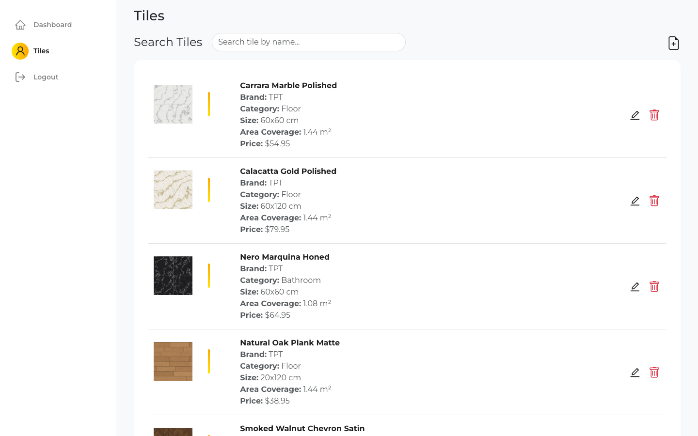
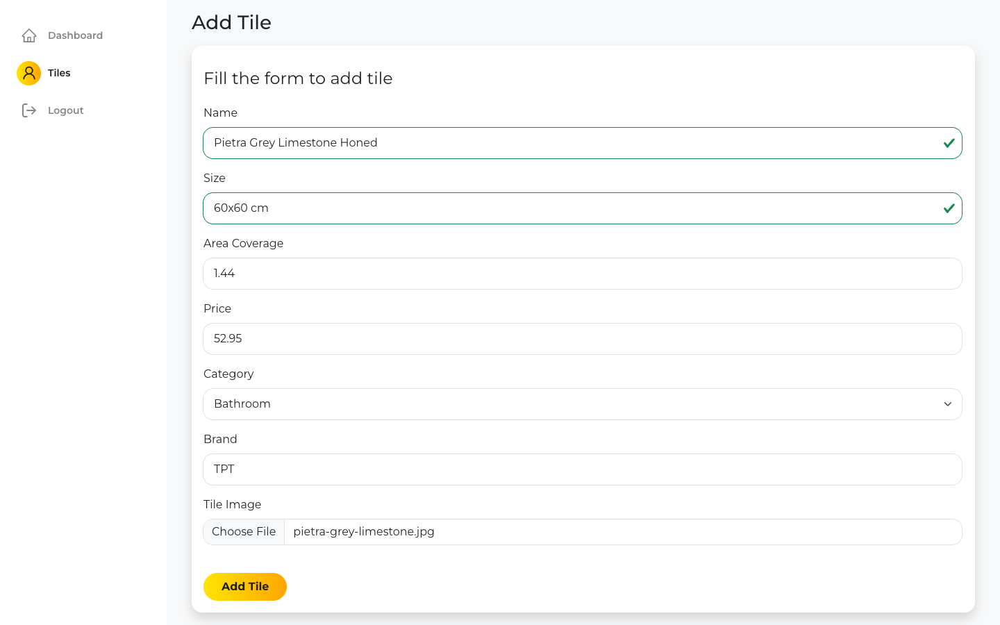
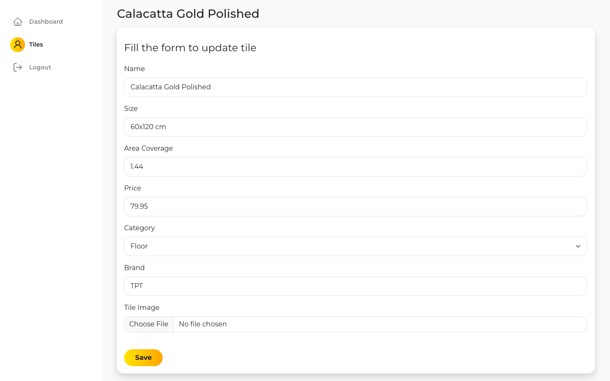
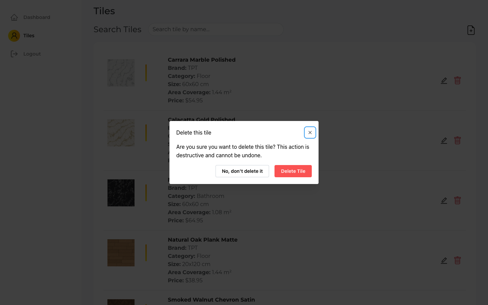
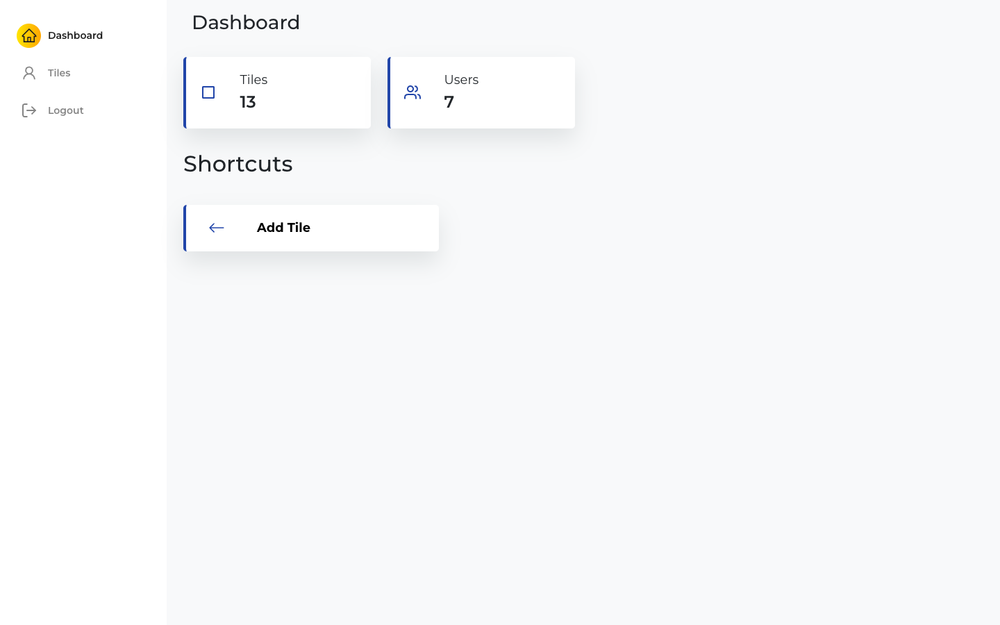
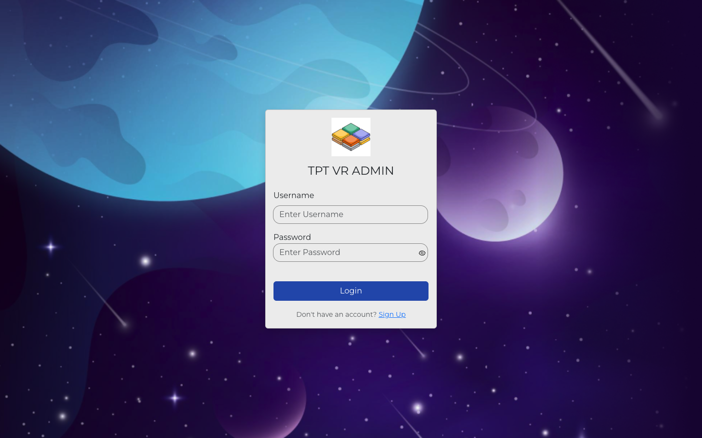

# VFloors360-Admin
VFloors360-Admin is the administrative dashboard for managing the VFloors360 virtual room visualization platform. It enables admins to upload and organize 3D room models, manage tile textures and categories, configure system settings, and monitor VR content in real-time. Built with React, Redux, and Axios, this panel ensures seamless content control and backend integration with the VFloors360-Client, supporting a dynamic and immersive user experience in virtual interior design.


> **Project Name:** VFloors360-Admin  
> **Repository:** [GitHub - khalid-syfullah/VFloors360-Admin](https://github.com/khalid-syfullah/VFloors360-Admin)

## 📘 Overview

**VFloors360-Admin** is the administrative dashboard for the VFloors360 ecosystem, supporting management of room models, tile assets, and other configurations required for immersive 360-degree VR visualization of interior spaces.

This admin interface complements the VR client application by providing the tools necessary for uploading, organizing, and maintaining the assets used in the client-side environment.

## 📸 Screenshots

Screens from a local run against [VFloors360-Server](https://github.com/khalid-syfullah/VFloors360-Server) with sample tiles (generated textures) and the 3D scenes in this repo.

<table>
  <tr>
    <td align="center" valign="top">
      <br>
      <b>Tile list</b><br><sub>Thumbnails, brand, category, size, coverage and price</sub>
    </td>
    <td align="center" valign="top">
      <br>
      <b>Add a tile</b><br><sub>Details and texture image</sub>
    </td>
  </tr>
  <tr>
    <td align="center" valign="top">
      <br>
      <b>Edit a tile</b><br><sub>Pre-filled form</sub>
    </td>
    <td align="center" valign="top">
      <br>
      <b>Delete a tile</b><br><sub>Confirmation before deleting</sub>
    </td>
  </tr>
  <tr>
    <td align="center" valign="top">
      <br>
      <b>Dashboard</b><br><sub>Tile and user counts</sub>
    </td>
    <td align="center" valign="top">
      <br>
      <b>Sign in</b><br><sub>Admin login</sub>
    </td>
  </tr>
</table>

## 🧰 Tech Stack

- **React.js** – Component-based UI development
- **Redux** – State management
- **Axios** – API communication
- **Bootstrap / Tailwind CSS** – Responsive UI design
- **Node.js & Express (optional backend)** – For API and asset management
- **MongoDB / Firebase / Supabase (optional)** – Storage solutions for model and texture metadata

## 🧩 Features

- ✅ Upload 3D models (.glb/.gltf) with associated metadata
- ✅ Manage tile and texture assets (floor, wall, door, etc.)
- ✅ Real-time preview of uploaded content
- ✅ Categorize models by room type (e.g., kitchen, bathroom)
- ✅ Edit or delete room configurations
- ✅ Secure admin authentication (planned)
- ✅ Role-based access control (future enhancement)

## 🛠️ Installation & Setup

### Prerequisites

- **Node.js** (v18 or later)
- **npm** (v9 or later)
- Admin backend API running (optional)

### Setup

```bash
# Clone the repository
git clone https://github.com/khalid-syfullah/VFloors360-Admin.git
cd VFloors360-Admin

# Install dependencies
npm install

# Start the development server
npm start
```

## 📂 Folder Structure

```
VFloors360-Admin/
│
├── public/                # Static assets
├── src/
│   ├── components/        # Reusable UI elements
│   ├── pages/             # Admin pages (Upload, Dashboard, etc.)
│   ├── redux/             # Redux actions, reducers, store
│   ├── services/          # Axios service calls
│   ├── utils/             # Utility functions
│   └── App.js             # Main app component
│
└── .env                   # Environment variables
```

## 🔌 API Integration

**Endpoints Used:**

- `GET /api/models` – Fetch uploaded room models
- `POST /api/models` – Upload new models
- `DELETE /api/models/:id` – Remove a model
- `GET /api/tiles` – List tile textures
- `POST /api/tiles` – Upload new tiles

> NOTE: Ensure the backend service is up and configured for CORS support.

## 🧪 Testing

- Manual testing through UI
- Integration testing of API routes
- Form validation for model uploads
- Feedback collection from internal stakeholders

## 🚀 Deployment

You can deploy this application using platforms like:

- **Vercel**
- **Netlify**
- **GitHub Pages**
- **Firebase Hosting**

Run the build command:

```bash
npm run build
```

Then upload the `build/` directory contents to your preferred hosting platform.

## 📈 Future Roadmap

- [ ] Implement voice-based upload interaction
- [ ] Admin notifications and error logging
- [ ] Role-based permissions
- [ ] Enhanced analytics dashboard

<!-- CONTRIBUTING -->
## Contributing

Follow these steps to fork and create a pull request:

### 🛠 Steps to Contribute

1. **Fork** the repository by clicking the "Fork" button on the top right of the [main repo page](https://github.com/Khalid-Syfullah/VFloors360-Admin).
2. **Clone** your forked repository to your local machine:
   ```bash
   git clone https://github.com/your-username/VFloors360-Admin.git
   cd VFloors360-Admin
   ```
3. **Create a new branch** from `main`:
   ```bash
   git checkout -b your-username/feature-name
   ```
4. **Make your changes** and commit them:
   ```bash
   git add .
   git commit -m "Describe your changes"
   ```
5. **Push your branch** to your fork:
   ```bash
   git push origin your-username/feature-name
   ```
6. **Open a Pull Request** on GitHub:
   - Go to your forked repository.
   - Click "Compare & pull request".
   - Ensure the base repository is `Khalid-Syfullah/VFloors360-Admin` and the base branch is `main`.
   - Add a clear title and description of your changes.
   - Submit the PR!

### 📌 Guidelines

- Keep your commits atomic and descriptive.
- Follow existing coding conventions.
- If you're unsure, open an issue first to discuss the change.


## 📜 License

MIT © [khalid-syfullah](https://github.com/khalid-syfullah)
